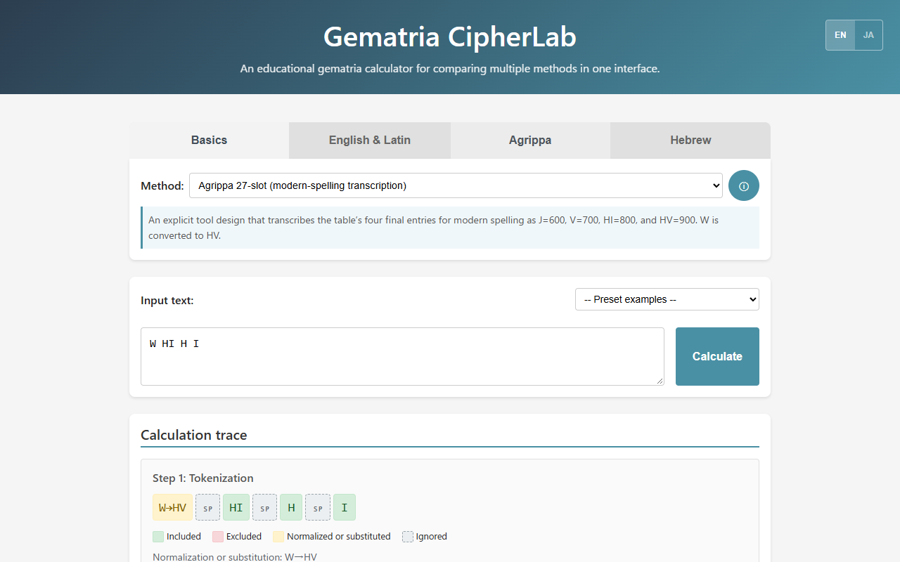

English · [日本語](README.md)

# Gematria CipherLab - Gematria Calculation Trace Tool


[](https://ipusiron.github.io/gematria-cipherlab/)

**Day109 - Security Tools Built with Generative AI 200**

Gematria CipherLab is a browser-only educational tool for examining seven letter-value methods through normalization, tokenization, value assignment, and summation. It distinguishes Agrippa’s 23-letter table from a 27-slot transcription for modern spelling and handles Hebrew points and presentation forms after Unicode normalization.

## 🌐 Live Demo

👉 [Open Gematria CipherLab](https://ipusiron.github.io/gematria-cipherlab/)

No installation is required. Text is processed only in the browser and is not sent elsewhere. The complete interface can be switched between English and Japanese.

## 📸 Screenshot



*Inspecting the W→HV substitution and total with the Agrippa 27-slot method*

## ✨ Features

- Compare seven methods in one interface
- Inspect the input, substituted tokens, values, and total step by step
- Distinguish included, substituted, excluded, and ignored input
- Use an on-screen keyboard for Hebrew Standard
- Switch the complete interface between English and Japanese and save the preference
- Use a mobile-first interface from a width of 320 pixels
- Run without external libraries, external APIs, or a build process

## 🎯 Use Cases

- Demonstrate how gematria totals depend on the selected method
- Compare the treatment of I/J, U/V, HI, and HV in Agrippa 23 and the 27-slot transcription
- Observe Hebrew ordinary forms, final forms, and input containing points
- Calculate the same word with A=0, A=1, and six times A=1
- Trace the arithmetic when checking spreadsheet or hand-calculated results

## 📖 Included Methods

| Screen | Method | Rule summary |
|---|---|---|
| English & Latin | English Zero-based | A=0 to Z=25 |
| English & Latin | English Ordinal | A=1 to Z=26 |
| English & Latin | English ×6 | Six times each English Ordinal value (A=6 to Z=156) |
| English & Latin | Latin 23 | Counts 23 letters from 1 to 23, J→I, U→V, and excludes W |
| Agrippa | Agrippa 23 | A–I=1–9, K–S=10–90, and T/V/X/Y/Z=100–500 |
| Agrippa | Agrippa 27-slot | U=200, J=600, V=700, HI=800, HV=900, and W→HV |
| Hebrew | Hebrew Standard | Counts 22 letters from 1 to 400, with the same values for final forms |

### Agrippa 23 and the 27-slot transcription

Agrippa 23 uses the 23 letters in the source table. In modern spelling, J is substituted with I, U with V, and W is excluded because it is not in the table.

Agrippa 27-slot is this tool’s transcription design for mapping the source table’s final “consonantal I,” “consonantal V,” “HI,” and “HV” entries to J, V, HI, and HV in modern input. U is 200, J is 600, V is 700, and W is substituted with HV=900. This design does not infer whether I or V in an original spelling was a vowel or consonant.

HI and HV are compound tokens only when contiguous. For example, `HI` is 800, while `H I` is 8+9=17.

### Hebrew Standard

The method maps א through ת to standard values from 1 through 400. The final forms ך, ם, ן, ף, and ץ have the same values as כ, מ, נ, פ, and צ. Input is normalized with NFKD, and points and cantillation marks are ignored without a warning. Therefore, `שָׁלוֹם` and `שלום` both total 376, and the presentation form `שׁ` decomposes and is calculated as ש=300.

## 🔬 Calculation Trace

The result is shown in three stages.

1. Tokenization: splits the input into method-specific tokens and marks substitutions, exclusions, and ignored characters
2. Value assignment: shows each included token and its value
3. Total: shows the addition and final total

| State | Meaning |
|---|---|
| Included | Defined by the method and added to the total |
| Normalized or substituted | Added after J→I, W→HV, Unicode normalization, or another stated transformation |
| Excluded | A letter that the selected method does not define |
| Ignored | Spaces, punctuation, digits, Hebrew points, cantillation marks, and similar separators or marks |

Input is limited to 10,000 characters. English and Latin methods apply NFKC and uppercase conversion; the Hebrew method applies NFKD.

## ⚠️ Limitations of the Result

An equal total does not prove a semantic relationship, prediction, authenticity, or cryptographic security. Results depend on the selected method, spelling, transcription, and Unicode normalization.

This tool is a calculator for checking letter-value correspondences. It does not judge historical or religious interpretations and cannot provide encryption, authentication, or tamper detection.

## 🔒 Security and Privacy

- Processes input in the browser without storing or transmitting it
- Renders user input with `textContent` and `replaceChildren()`
- Declares a CSP including `script-src 'self'` and `connect-src 'none'`
- Recursively freezes calculation tables and results against runtime mutation
- Loads no external libraries

GitHub Pages does not let this repository set HTTP response headers such as `X-Frame-Options`. Because `frame-ancestors` is also ineffective in an HTML CSP meta element, the public page does not guarantee that embedding is blocked.

## 🚀 Usage

1. Choose English & Latin, Agrippa, or Hebrew.
2. Select a method when the tab offers more than one.
3. Enter text or choose a preset.
4. Select Calculate and inspect the trace and reference table.

For local use, open `index.html` directly. You can also serve the directory from a local HTTP server; no build step is required.

## 🧪 Tests

With Node.js 22 or later, run the tests without installing dependencies.

```console
npm test
```

The suite covers representative values for all seven methods, Agrippa longest matching and boundaries, Hebrew normalization, data immutability, English/Japanese message parity, and HTML/CSP requirements.

## 📁 Directory Structure

```text
gematria-cipherlab/
├── .github/
│   └── workflows/
│       └── test.yml          # Runs tests with Node.js 22
├── assets/
│   ├── en/
│   │   └── screenshot.png    # English interface screenshot
│   └── screenshot.png        # Japanese interface screenshot
├── docs/
│   ├── detailed_design.md    # Calculation core and data-processing design
│   └── ui_spec.md            # Interface, interaction, and responsive specification
├── test/
│   ├── core.test.js          # Calculation-core tests
│   ├── html.test.js          # HTML and CSP tests
│   ├── i18n.test.js          # English/Japanese message tests
│   └── readme.test.js        # README synchronization tests
├── gematria-core.js          # DOM-independent calculation core
├── messages.js               # English and Japanese messages
├── script.js                 # Interface control and result rendering
├── style.css                 # Mobile-first styles
├── index.html                # Application screen
├── README.md                 # Japanese README
├── README.en.md              # English README
├── CLAUDE.md                 # Development rules and architecture
├── package.json              # Test command
└── LICENSE                   # MIT License
```

## 🔗 References

- [Agrippa, *De occulta philosophia*, Book II, Chapter XX](https://www.alchemy-texts.com/book/three-books-of-occult-philosophy/)
- [Internet Archive: *De Occulta Philosophia* (1533 edition)](https://archive.org/details/DeOccultaPhilosophiaLoc1533)
- [Jewish Encyclopedia: “Gematria”](https://www.jewishencyclopedia.com/articles/6571-gematria)
- [Unicode Names List: Hebrew](https://unicode.org/Public/18.0.0/charts/nameslist/0590/)
- [Unicode Names List: Alphabetic Presentation Forms](https://www.unicode.org/Public/UCD/latest/charts/nameslist/fb00/)

## 📄 License

This project uses the MIT License. See [LICENSE](LICENSE) for details.

## 🛠️ About This Tool

This tool is Day109 of the “Security Tools Built with Generative AI 200” project. See [Security Tools Built with Generative AI 200](https://akademeia.info/?page_id=44607) for the overall project and other tools.
