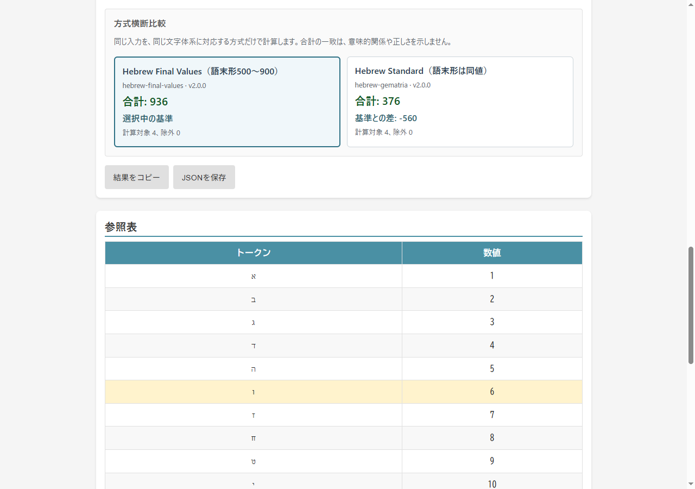

<!--
---
id: day109
slug: gematria-cipherlab

title: "Gematria CipherLab"

subtitle_ja: "ゲマトリア計算トレースツール"
subtitle_en: "Gematria Calculation Trace Tool"

description_ja: "8種類の文字数値対応を、計算トレース・方式比較・行別内訳・検証付きJSON・共有URLとともに確認できる学習用Webツール"
description_en: "Educational web tool for inspecting eight letter-value methods with traces, comparison, line breakdowns, verified JSON, and share URLs"

category_ja:
  - 古典暗号
  - 数秘術
category_en:
  - Classical Cryptography
  - Numerology

difficulty: 1

tags:
  - gematria
  - agrippa-cipher
  - numerology
  - cryptography
  - static-web

repo_url: "https://github.com/ipusiron/gematria-cipherlab"
demo_url: "https://ipusiron.github.io/gematria-cipherlab/"

hub: true
---
-->

[English](README.en.md) · 日本語

# Gematria CipherLab - ゲマトリア計算トレースツール


[](https://ipusiron.github.io/gematria-cipherlab/)

**Day109 - 生成AIで作るセキュリティツール200**

文字へ数値を割り当てる8種類の方式を、正規化・トークン化・数値割当・合計の順に確認できる、ブラウザー完結型の学習用ツールです。同じ文字体系の方式比較、行・空白区切りの内訳、検証付きJSON読込、入力を既定で含めない共有URLにも対応します。

## 🌐 デモページ

👉 [Gematria CipherLabを開く](https://ipusiron.github.io/gematria-cipherlab/)

インストールは不要です。入力した文字列はブラウザー内だけで処理され、外部へ送信されません。画面は日本語と英語を切り替えられます。

## 📸 スクリーンショット



*複数行入力を行・空白区切りで確認し、Hebrew StandardとFinal Valuesを比較している画面*

## ✨ 特徴

- 8種類の方式を収録し、同じ文字体系の方式を自動比較
- 入力文字、置換後トークン、値、合計を段階表示
- 計算対象・置換・除外・無視を色分け
- Hebrew Standardと語末形500〜900方式を切り替えられるオンスクリーンキーボード
- 方式ID・方式版・トレース・比較結果を含むコピーと再現用JSON
- 保存JSONを再計算し、合計・トレース・比較が一致した場合だけ復元
- 複数行を行と空白区切りのセグメントへ分けた内訳
- 言語・方式だけ、または明示的に入力を含める共有URL
- 日本語・英語の完全切替と設定保存
- 320px幅から使えるモバイルファーストUI
- 外部ライブラリー、外部API、ビルド処理なし

## 🎯 ユースケース

- `שלום`がHebrew Standardでは376、語末形500〜900方式では936になる差を確認する
- `COMPUTER`をEnglish Ordinalの111とEnglish ×6の666で並べ、6倍関係を検算する
- Agrippa 23と27枠転写で、I/J・U/V・HI/HVの扱いと除外文字の差を比較する
- ヘブライ文字の通常形・語末形・母音記号・表示形を含む入力を観察する
- 方式IDと版を含むJSONを保存し、授業・記事・検算で計算条件を共有する
- 保存JSONを読み戻し、合計やトレースが書き換えられていないか検証する
- `שלום חי`と`אמת`を別行に置き、行合計と空白区切りの内訳を確認する
- 入力本文をURLへ入れず、選択した言語と方式だけを共同作業者へ渡す

## 📖 収録方式

| 画面 | 方式 | 規則の概要 |
|---|---|---|
| 英語・ラテン文字 | English Zero-based | A=0〜Z=25 |
| 英語・ラテン文字 | English Ordinal | A=1〜Z=26 |
| 英語・ラテン文字 | English ×6 | English Ordinalの各値を6倍（A=6〜Z=156） |
| 英語・ラテン文字 | Latin 23 | 23文字を1〜23で数え、J→I、U→V、Wは除外 |
| Agrippa | Agrippa 23 | A〜I=1〜9、K〜S=10〜90、T/V/X/Y/Z=100〜500 |
| Agrippa | Agrippa 27枠 | U=200、J=600、V=700、HI=800、HV=900、W→HV |
| ヘブライ文字 | Hebrew Standard | 22文字を1〜400で計算し、語末形は通常形と同値 |
| ヘブライ文字 | Hebrew Final Values | 通常形は1〜400、語末形ך・ם・ן・ף・ץは500〜900 |

### Agrippa 23と27枠転写

Agrippa 23は原表の23文字を使います。現代綴りに含まれるJはI、UはVへ置き換え、Wは表にない文字として除外します。

Agrippa 27枠は、原表末尾の「子音のI」「子音のV」「HI」「HV」を、現代入力でそれぞれJ、V、HI、HVへ対応させる本ツールの転写設計です。Uは200、Jは600、Vは700になり、WはHV=900へ置き換えます。この設計は、原綴りにあるI/Vの母音・子音を自動判定するものではありません。

HIとHVは連続している場合だけ複合トークンです。たとえば`HI`は800ですが、`H I`は8+9=17です。

### Hebrew Standardと語末形500〜900方式

א〜תを標準値1〜400へ対応させます。ך・ם・ן・ף・ץは、それぞれכ・מ・נ・פ・צと同じ値です。入力はNFKDで正規化し、母音記号と朗誦記号を警告なしで無視します。そのため、`שָׁלוֹם`は`שלום`と同じ376になり、表示形`שׁ`も分解してש=300として計算します。

Hebrew Final Valuesは別方式として、5つの語末形だけをך=500、ם=600、ן=700、ף=800、ץ=900で数えます。たとえば`שלום`は、末尾のםを40とするStandardでは376、600とするFinal Valuesでは936です。語末形を含まない`חי`は、どちらも18です。この差は方式選択の差であり、一方が他方より正しいという採点ではありません。

## 🔬 計算トレース

結果は次の3段階で表示します。

1. Tokenization: 入力を方式固有のトークンへ分け、置換・除外・無視を示す
2. Value assignment: 各計算対象トークンと数値を対応させる
3. Total: 値の加算式と合計を示す

| 状態 | 意味 |
|---|---|
| 計算対象 | 方式の表にあり、合計へ加える |
| 正規化・置換 | J→I、W→HV、Unicode正規化などを経て合計へ加える |
| 除外 | 文字ではあるが、選択した方式に定義がない |
| 無視 | 空白、句読点、数字、ヘブライ文字の母音記号・朗誦記号など |

入力は最大10,000文字です。英語・ラテン文字方式ではNFKCと大文字化、ヘブライ文字方式ではNFKDを適用します。空白、タブ、改行は区切りとして無視します。Enterは改行、Ctrl／⌘＋Enterは計算です。

合計の下には、物理行と空白区切りのセグメントごとの合計・計算対象数・除外数を表示します。これは言語学的な単語判定ではありません。計算後は、選択方式を基準として同じ文字体系の全方式をカードで比較します。差は数値差だけを示し、一致や近さを意味・信頼度として採点しません。

「結果をコピー」は方式名・方式ID・方式版・トレース・行内訳・比較結果を含むテキストを作ります。「JSONを保存」は完全な分析結果を機械可読な`gematria-cipherlab.analysis`形式で保存します。保存データに時刻を入れないため、同じ入力と方式から同じJSONを再生成できます。「JSONを読み込む」は1MB以下の`formatVersion: 1`を入力・方式から再計算し、全フィールドが一致した場合だけ復元します。

共有URLは既定で表示言語と方式だけを含みます。「入力本文をURLに含める」を選んだ場合だけ入力を追加し、4,000文字を超えるURLは作りません。入力を含むURLはブラウザー履歴や共有先に残る可能性があります。

## ⚠️ 結果の限界

同じ合計値は、語同士の意味的関係、予言、真正性、暗号としての安全性を証明しません。結果は、選んだ方式、綴り、転写、Unicode正規化に左右されます。

このツールは文字と数値の対応を確認する計算器です。歴史的・宗教的な解釈の正しさを判定せず、暗号化や認証にも使用できません。JSON読込時の再計算は本ツール内の整合性確認であり、電子署名、作成者認証、第三者による改ざん証明ではありません。入力と結果を揃えて再生成されたJSONは検出できません。

## 🔒 セキュリティとプライバシー

- 入力はブラウザー内で処理し、保存・送信しない
- ユーザー入力の描画に`textContent`と`replaceChildren()`を使用
- `script-src 'self'`、`connect-src 'none'`などのCSPをHTMLで設定
- 計算表と計算結果を再帰的に凍結し、実行中の変更を防止
- コピーとJSONはブラウザー内で生成し、外部サービスへ送信しない
- 読み込んだJSONの表示値を信用せず、入力と方式から再計算して完全一致を確認
- 共有URLは入力を既定で含めず、含める場合は画面上の選択を必要とする
- 外部ライブラリーを読み込まない

GitHub Pagesでは、このリポジトリーから`X-Frame-Options`などのHTTPレスポンスヘッダーを設定できません。HTMLのCSPメタ要素では`frame-ancestors`も有効にならないため、公開ページの埋め込み禁止は保証していません。

## 🚀 使い方

1. 「英語・ラテン文字」「Agrippa」「ヘブライ文字」からタブを選びます。
2. 必要なら方式を選択します。
3. テキストを入力するか、プリセットを選びます。複数行はEnterで入力できます。
4. 「計算」またはCtrl／⌘＋Enterで、トレース、行内訳、方式横断比較、参照表を確認します。
5. 必要に応じて結果をコピーするか、再現用JSONを保存します。保存JSONは「JSONを読み込む」で検証・復元できます。
6. 共有URLは入力本文を含めるか確認してからコピーします。既定では言語と方式だけを含みます。

ローカルでは`index.html`を直接開けます。ローカルHTTPサーバーから配信する場合も、追加のビルドは不要です。

## 🧪 テスト

Node.js 22以降で、依存パッケージをインストールせずに実行できます。

```console
npm test
```

テストでは、8方式の代表値、Agrippaの最長一致と境界、ヘブライ文字の正規化と語末形500〜900、改行・タブ、行内訳、方式比較、JSONの再計算検証と改変拒否、データの不変性、日英メッセージの対応、HTML/CSPの要件を確認します。

## 📁 ディレクトリー構造

```text
gematria-cipherlab/
├── .github/
│   └── workflows/
│       └── test.yml          # Node.js 22で自動テスト
├── assets/
│   ├── en/
│   │   └── screenshot.png    # 英語画面のスクリーンショット
│   └── screenshot.png        # 日本語画面のスクリーンショット
├── docs/
│   ├── detailed_design.md    # 計算コアとデータ処理の設計
│   └── ui_spec.md            # 画面・操作・レスポンシブ仕様
├── test/
│   ├── core.test.js          # 計算コアのテスト
│   ├── html.test.js          # HTMLとCSPのテスト
│   ├── i18n.test.js          # 日英メッセージのテスト
│   └── readme.test.js        # README同期のテスト
├── gematria-core.js          # DOMに依存しない計算コア
├── messages.js               # 日本語・英語メッセージ
├── script.js                 # 画面制御と結果描画
├── style.css                 # モバイルファーストのスタイル
├── index.html                # アプリケーション画面
├── README.md                 # 日本語版README
├── README.en.md              # 英語版README
├── CLAUDE.md                 # 開発時の規則と構成
├── package.json              # テストコマンド
└── LICENSE                   # MITライセンス
```

## 🔗 参考資料

- [Agrippa, *De occulta philosophia*, Book II, Chapter XX](https://www.alchemy-texts.com/book/three-books-of-occult-philosophy/)
- [Internet Archive: *De Occulta Philosophia*（1533年版）](https://archive.org/details/DeOccultaPhilosophiaLoc1533)
- [Jewish Encyclopedia: “Gematria”](https://www.jewishencyclopedia.com/articles/6571-gematria)
- [Jewish Encyclopedia: “Arithmetic”](https://www.jewishencyclopedia.com/articles/1776-arithmetic)
- [Unicode Names List: Hebrew](https://unicode.org/Public/18.0.0/charts/nameslist/0590/)
- [Unicode Names List: Alphabetic Presentation Forms](https://www.unicode.org/Public/UCD/latest/charts/nameslist/fb00/)

## 📄 ライセンス

MIT Licenseです。詳細は[LICENSE](LICENSE)を参照してください。

## 🛠️ このツールについて

本ツールは「生成AIで作るセキュリティツール200」プロジェクトのDay109として制作しています。プロジェクト全体と他のツールは、[生成AIで作るセキュリティツール200](https://akademeia.info/?page_id=44607)を参照してください。
